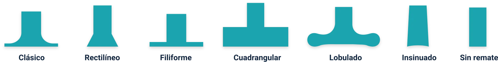

import InfoCard from '@/components/blog/mdx/InfoCard.astro'
import LinkButton from '@/components/blog/mdx/LinkButton.astro'
import ImagenAmpliable from '@/components/blog/mdx/ImagenAmpliable.astro'
import tiposMoviles from './img/historia-tipos-moviles.webp'
import imprenta from './img/historia-imprenta-gutenberg.webp'
import evolucionLetra from './img/historia-evolucion-letra.webp'
import linotipia from './img/historia-linotipia.webp'
import serif from './img/clasificacion-serif.webp?url'
import sansSerif from './img/clasificacion-sans-serif.webp?url'
import script from './img/clasificacion-script.webp?url'
import decorativa from './img/clasificacion-decorativa.webp?url'
import lineas from './img/anatomia-lineas.webp'
import partes from './img/anatomia-partes.webp'
import humana from './img/estilo-humana.webp'
import garalda from './img/estilo-garalda.webp'
import transicion from './img/estilo-transicion.webp'
import didona from './img/estilo-didona.webp'
import mecana from './img/estilo-mecana.webp'
import grotesca from './img/estilo-grotesca.webp'
import geometrica from './img/estilo-geometrica.webp'
import humanistica from './img/estilo-humanistica.webp'
import incisa from './img/estilo-incisa.webp?url'
import caligrafica from './img/estilo-caligrafica.webp?url'
import manual from './img/estilo-manual.webp?url'
import gotica from './img/estilo-gotica.webp?url'

La **tipografía** es el oficio de elegir y usar tipos (letras diseñadas con unidad de estilo) para comunicar un mensaje, en soporte físico o digital. Cada fuente es un conjunto completo de letras, números y signos con características comunes.

***Para qué sirve saberlo:*** elegir la fuente adecuada cambia cómo se lee y cómo se siente una pieza.

## Historia en una tabla

| Época | Qué pasó |
| --- | --- |
| **Siglo XV** | Gutenberg desarrolla el **tipo móvil**: un bloque con una letra grabada, que se combina para armar palabras y párrafos. |
| **1486 y 1496** | Ratdolt publica el primer catálogo de tipos y Aldo Manuzio funda su imprenta en Venecia. |
| **Siglo XVI** | Época de oro de la tipografía francesa: Garamond, cuyo tipo aún lleva su nombre. En Alemania aparecen las góticas Fraktur y Schwabacher. |
| **1692** | Luis XIV encarga un comité para crear un tipo con principios científicos: el *Romain du roi*. |
| **Hacia 1800** | Aparece el **sans serif**, cuestionado al principio por simple y luego popular por su legibilidad. |
| **Hacia 1880** | Linotype y Monotype aceleran la composición de periódicos. |
| **Siglo XX** | Nacen las familias conocidas (Arial, Times, Futura, Helvética, Palatino…). La litografía offset reemplaza el metal y llegan las computadoras. |
| **Web** | La revolución digital se consolidó en una sola década, y con internet llega la tipografía para pantalla. |

  <PhotoNote src={tiposMoviles} alt="Bloques de metal con letras grabadas al revés">**Tipos móviles:** cada bloque de metal lleva una letra grabada al revés. Se combinaban a mano para armar palabras y párrafos.</PhotoNote>
  <PhotoNote src={imprenta} alt="Grabado de Gutenberg y sus ayudantes junto a la imprenta">**La imprenta de Gutenberg:** el siglo XV mecaniza la producción de textos.</PhotoNote>
  <PhotoNote src={evolucionLetra} alt="Un romano pintando una inscripción, un copista medieval y la evolución de la letra G">**De la mano a la letra:** la G pasa de la inscripción romana y el manuscrito a la forma que conocemos.</PhotoNote>
  <PhotoNote src={linotipia} alt="Grabado de una máquina linotipia">**Linotipia (hacia 1880):** compone líneas completas de texto y acelera los periódicos.</PhotoNote>

---

## Clasificación

Por su anatomía, las fuentes se agrupan en cuatro familias.

Fíjate cómo la misma palabra cambia de carácter con cada familia:

  <InfoCard number={1} variant="purple" image={serif} imageAlt="La palabra Tecnología en una fuente serif" title="Serif" description="Con remates. Cómodas para textos largos. Transmiten tradición y seriedad." />
  <InfoCard number={2} variant="secondary" image={sansSerif} imageAlt="La palabra Tecnología en una fuente sans serif" title="Sans serif" description="Sin remates, también llamadas de palo seco o lineales." />
  <InfoCard number={3} variant="pink" image={script} imageAlt="La palabra Tecnología en una fuente script" title="Script" description="Imitan la escritura a mano. Mejores para frases cortas o firmas." />
  <InfoCard number={4} variant="green" image={decorativa} imageAlt="La palabra Tecnología en una fuente decorativa" title="Decorativas" description="Estilo propio y fin decorativo. Para frases puntuales, no para textos largos." />

| Familia | Ejemplos |
| --- | --- |
| **Serif** | Garamond, Times New Roman, Palatino, Didot, Georgia |
| **Sans serif** | Helvética, Futura |
| **Script** | Edwardian Script, Brush Script, Mistral, Comic Sans |
| **Decorativas** | Pop Art, Bangers, Art Nouveau |

### Cuatro rasgos para describir una fuente

- **Cuerpo:** su tamaño, medido en puntos tipográficos.
- **Anchura del trazo:** fina, redonda, negra o supernegra.
- **Inclinación del eje vertical:** lo que define las itálicas o cursivas.
- **Proporción:** expandida, estrecha o redonda.

---

## Anatomía del tipo

Las letras se apoyan en dos líneas de referencia: la **línea base** (sobre ella se asientan las minúsculas y las mayúsculas) y la **línea media** (el límite de altura de las minúsculas, también llamado ojo medio). Arriba queda la **altura de las mayúsculas** y abajo, la **altura de los descendentes**.

<PhotoNote src={lineas} alt="La palabra Axpho sobre cuatro líneas: altura de mayúsculas, línea media, línea base y altura de descendentes">

La "p" baja de la línea base (**descendente**) y la "h" sube por encima de la línea media (**ascendente**).

</PhotoNote>

### Partes de la letra

<ImagenAmpliable src={partes} alt="La palabra TiphgrAfoEQ con sus partes señaladas: ascendente, oreja, vértice, travesaño, brazo, asta, remate, descendente, ojal, barra transversal y cola" />

| Parte | Qué es |
| --- | --- |
| **Asta** | El trazo que forma la estructura básica de la letra. |
| **Remate** | Trazo breve al final de un asta, perpendicular o inclinado. |
| **Ascendente** | Parte de la minúscula que sube por encima de la línea media. |
| **Descendente** | Parte de la minúscula que baja por debajo de la línea base. |
| **Oreja** | Terminación añadida a algunas letras, como la g. |
| **Ojal** | Parte inferior cerrada de la g minúscula. |
| **Vértice** | Punto donde se unen dos astas inclinadas. |
| **Barra transversal** | Línea horizontal entre verticales, diagonales o curvas. |
| **Travesaño** | Línea horizontal que cruza el trazo principal. |
| **Brazo** | Trazo horizontal o diagonal que sale de uno vertical. |
| **Cola** | Continuación de la parte inferior de algunos rasgos. |

### Tipos de remate

Los remates pueden ser clásicos, rectilíneos, filiformes, cuadrangulares, lobulados, insinuados o inexistentes:

---

## Estilos tipográficos

Los estilos permiten distinguir visualmente un título de un subtítulo, una nota o una cita. Se agrupan en varias familias. La más numerosa es la de las **romanas**.

### Las romanas (con remates)

Del más antiguo al más reciente. Las anotaciones de cada imagen señalan los rasgos que los distinguen: fíjate sobre todo en el **contraste** entre trazos gruesos y finos y en el **eje** de la "e" y la "o".

<PhotoNote src={humana} alt="Muestra ABdefg en estilo humano con flechas: filete inclinado en la e, espaciado amplio, poco contraste, modulación oblicua y descendentes largas">

**Humanas o venecianas** (hacia 1460): poco contraste, la barra de la "e" inclinada y espaciado amplio. Hoy se usan en publicidad y textos breves. *Ej.: Jenson, Centaur.*

</PhotoNote>

<PhotoNote src={garalda} alt="Muestra ABdefg en estilo garalda con flechas: filete horizontal en la e, contraste medio, modulación oblicua y trazos terminales ligeros">

**Antiguas o garaldas** (siglos XV al XVII): contraste medio y la "e" ya horizontal. Muy legibles en texto continuo. *Ej.: Garamond, Bembo, Caslon.*

</PhotoNote>

<PhotoNote src={transicion} alt="Muestra ABdefg en estilo de transición con flechas: gran contraste, modulación casi vertical, trazos terminales delgados y gotas pequeñas">

**De transición o reales:** más contraste y eje casi vertical. Son el puente entre garaldas y didonas. *Ej.: Baskerville, Century Schoolbook.*

</PhotoNote>

<PhotoNote src={didona} alt="Muestra ABdefg en estilo didona con flechas: contraste abrupto, fuerte modulación vertical, espaciado estrecho y gran altura x">

**Didonas o modernas** (desde 1784): contraste abrupto, eje vertical y espaciado estrecho. Elegantes en textos cortos. *Ej.: Bodoni, Didot.*

</PhotoNote>

<PhotoNote src={mecana} alt="Muestra ABdefg en estilo mecano con flechas: sin contraste en sus trazos, trazos terminales cuadrados y espaciado ancho">

**Mecanas o egipcias** (desde 1817): sin contraste y con remates cuadrados y gruesos. Pensadas para publicidad. *Ej.: Clarendon, Rockwell.*

</PhotoNote>

### Las lineales o de palo seco (sin remates)

<PhotoNote src={grotesca} alt="Muestra ABdefg en estilo grotesco con flechas: elevada altura x y trazos que se estrechan en las uniones">

**Grotescas y neogrotescas** (siglo XIX): altura x elevada y trazos que se adelgazan en las uniones. *Ej.: Univers, Helvética.*

</PhotoNote>

<PhotoNote src={geometrica} alt="Muestra ABdefg en estilo geométrico con flechas: vértice puntiagudo y ojal abierto">

**Geométricas** (1920): construidas con círculos y rectas. *Ej.: Futura, Avant Garde.*

</PhotoNote>

<PhotoNote src={humanistica} alt="Muestra ABdefg en estilo humanístico con flechas: vértice plano, remates engrosados, ligero contraste y g descendente">

**Humanísticas:** basadas en las romanas, con un ligero contraste que recuerda la caligrafía. *Ej.: Gill Sans.*

</PhotoNote>

### Las demás familias

  <InfoCard number={1} variant="cream" image={incisa} imageAlt="La palabra Incisas en una fuente incisa" title="Incisas" description="Entre romanas y lineales: el trazo se ensancha al final. Ej.: Óptima, Albertus." />
  <InfoCard number={2} variant="secondary" image={caligrafica} imageAlt="La palabra Caligráficas en una fuente caligráfica" title="Caligráficas" description="Inspiradas en la escritura personal, con letras sueltas o enlazadas. Ej.: Mistral." />
  <InfoCard number={3} variant="pink" image={manual} imageAlt="La palabra Manuales en una fuente manual" title="Manuales" description="Escritura espontánea e informal, como de marcador o pincel. Ej.: Comic Sans." />
  <InfoCard number={4} variant="purple" image={gotica} imageAlt="La palabra Góticas en una fuente gótica" title="Góticas" description="Formas medievales y arcaicas, hechas como a pluma. Ej.: Goudy Text." />

- **No latinas:** escrituras que no usan caracteres latinos.
- **De fantasía:** fuera de norma. Pueden ser de diseño (como las esténcil) u ornamentales.

---

## Criterios compositivos

Tres decisiones que pesan más que las demás al armar una composición tipográfica.

  <InfoCard number={1} variant="purple" title="Elegir la fuente" description="Cada una tiene personalidad. Las romanas dan formalidad; las gestuales, informalidad. Puede reforzar o contradecir el mensaje." />
  <InfoCard number={2} variant="secondary" title="Combinar contrastes" description="Combinar familias amplía los contrastes de estilo y tamaño. No hay reglas fijas: se prueba y se experimenta." />
  <InfoCard number={3} variant="pink" title="Contraste de tamaño" description="El cuerpo no es el tamaño visual de la letra: cada fuente se ve distinta con el mismo cuerpo." />

- <mark>Texto largo:</mark> una romana antigua como Garamond, en caja baja, se lee mejor.
- <mark>Frases cortas o señalética:</mark> una neogrotesca como Helvética funciona mejor.

<LinkButton
  href="https://zajuna.sena.edu.co/Repositorio/Titulada/institution/SENA/Arte/522309/Contenido/OVA/CF12/index.html#/curso/tema2"
  title="Tema 2 del curso"
  description="Producción de editoriales y tipografía, SENA. Fuente de estos apuntes y de sus imágenes."
/>
