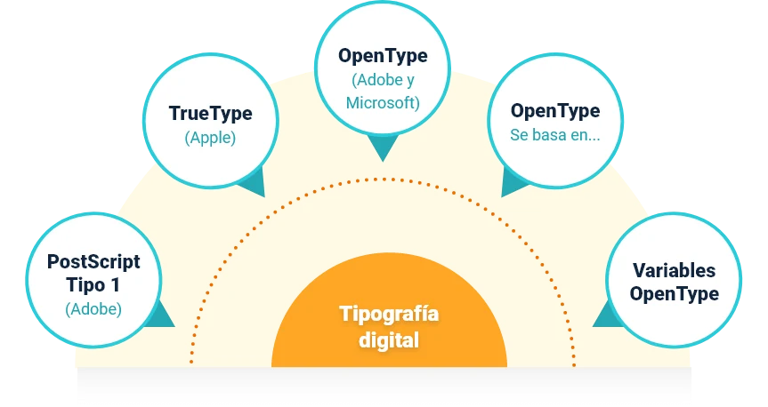

import InfoCard from '@/components/blog/mdx/InfoCard.astro'
import LinkButton from '@/components/blog/mdx/LinkButton.astro'
import ImagenAmpliable from '@/components/blog/mdx/ImagenAmpliable.astro'
import caligrafia from './img/caligrafia.webp'
import rotulacion from './img/rotulacion.webp'
import tipografia from './img/tipografia.webp'
import fuenteCompleta from './img/fuente-completa.webp'
import tipografiaCreativa from './img/tipografia-creativa.webp'
import medidas from './img/medidas-tamanos.webp'
import editorFuentes from './img/editor-de-fuentes.webp'
import jerarquia from './img/jerarquia-contraste.webp'
import reticula from './img/reticula-partes.webp'
import vectorial from './img/ilustracion-vectorial.webp'

## Tipografía, rotulación y caligrafía

Se confunden mucho. Lo que las separa es **cómo se hace la letra**:

  <PhotoNote src={caligrafia} alt="Pluma estilográfica escribiendo una firma">**Caligrafía = escritura.** Se traza con una herramienta (pluma, pincel, lápiz) y cada trazo forma parte de la letra.</PhotoNote>
  <PhotoNote src={rotulacion} alt="Dos frases en inglés dibujadas a mano con letras distintas y adornos">**Rotulación = dibujo.** La letra se construye, se retoca y se mejora hasta que queda perfecta. Ilustra la información.</PhotoNote>
  <PhotoNote src={tipografia} alt="Letras ABCD con trazos de construcción y un alfabeto completo debajo">**Tipografía = sistema.** Letras hechas por un diseñador de tipos y convertidas en fuente, para reutilizar en computador.</PhotoNote>

***Truco para saber cuál es:*** compara la misma letra en una palabra. Si la "a" es idéntica en todas partes, es una fuente. Si cambia, se dibujó una por una.

El video del curso refuerza el tema de jerarquía tipográfica:

<VideoFrame
  youtube="https://www.youtube.com/watch?v=u2eha348YVU"
  title="Jerarquía tipográfica"
  caption="Jerarquía tipográfica, del curso del SENA."
/>

---

## Forma y función

La letra comunica por su apariencia. En el diseño, el mensaje de una fuente tiene que coincidir con lo que la pieza quiere decir. Hay dos enfoques, y se complementan:

<TwoColumns>

<PhotoNote src={fuenteCompleta} alt="Alfabeto completo, números y signos de una fuente esténcil sobre fondo verde azulado">

**Diseño de fuente:** letras, números y signos pensados como un conjunto que funcione en cualquier texto.

</PhotoNote>

<PhotoNote src={tipografiaCreativa} alt="Cartel con la palabra Poderosa armada con letras recortadas de distintas fuentes">

**Tipografía creativa:** en este cartel las letras son la imagen. Llama la atención, aunque cueste más leerlo.

</PhotoNote>

</TwoColumns>

| | Tipografía editorial | Tipografía creativa |
| --- | --- | --- |
| **Prioridad** | Que se lea fácil | Llamar la atención |
| **Se ocupa de** | Tamaño, espaciado entre letras, palabras y líneas, ancho de columna | Usar el texto como imagen o metáfora visual |
| **Dónde se ve** | El texto interior de un libro | Portada, título, póster, anuncio |

Una fuente con mucha personalidad puede estorbar la lectura fluida. Por eso, en un libro la portada se piensa distinto al interior. Además, un lector experto no lee letra por letra sino **la forma de la palabra completa**.

---

## Medidas tipográficas

- **Punto (pt):** la unidad más usada para el tamaño de letra y el espaciado entre líneas.
- **Punto DTP o PostScript:** 1/72 de pulgada (0,352 mm).
- **Pica:** 12 puntos.

| Grupo | Tamaño | Uso |
| --- | --- | --- |
| **Referencia** | 5 a 8 pt | Notas al pie, guías, diccionarios |
| **Texto** | 8 a 12 pt | Cuerpo de libros |
| **Visualización** | 14 pt o más | Titulares, pancartas, carteles |

<PhotoNote src={medidas} alt="Tipómetro con la letra E repetida en tamaños crecientes y una regla graduada">

Un **tipómetro**: la misma letra en distintos cuerpos. Sirve para medir el tamaño de un texto impreso.

</PhotoNote>

---

## Tipografía digital

Las fuentes actuales son **vectoriales**: se escalan sin perder calidad. En 1985 llegaron PostScript, el Macintosh, la LaserWriter y PageMaker, y nació la **autoedición**.

<PhotoNote src={editorFuentes} alt="Programa FontLab con la tabla de caracteres de una fuente abierta">

En un **editor de fuentes** como FontLab, cada carácter de la tabla es un dibujo vectorial.

</PhotoNote>

| Formato | Lo esencial |
| --- | --- |
| **PostScript Tipo 1** (Adobe) | La primera tecnología vectorial. Usa curvas de Bézier y dos archivos: pantalla e impresión. |
| **TrueType** (Apple) | Un solo archivo para pantalla e impresión. Estándar en multimedia. |
| **OpenType** (Adobe y Microsoft) | Multiplataforma, un archivo por fuente y basado en Unicode: más de 65.000 glifos y soporte de ligaduras. |
| **OpenType variable** | Varias fuentes en un solo archivo. Muy útil en diseño web adaptable. |

---

## Jerarquía y legibilidad

La **jerarquía tipográfica** son las decisiones de fuente y formato que hacen evidente qué texto es más importante.

<PhotoNote src={jerarquia} alt="La palabra type enorme en negro, la frase i love pequeña en rojo y palabras grises de fondo">

Aquí se lee primero **"type"** (tamaño), luego **"i love"** (color) y al final el fondo gris. Eso es jerarquía.

</PhotoNote>

Cuatro pasos para armarla:

  <InfoCard number={1} variant="secondary" title="Cuerpo de texto" description="Se define primero. Lo ideal son 50 a 60 caracteres por línea; luego se definen títulos, notas y citas." />
  <InfoCard number={2} variant="pink" title="Pesos visuales" description="Títulos con trazo grueso o mayúsculas. En cuerpo de texto, fuentes más delgadas y con mayúsculas y minúsculas." />
  <InfoCard number={3} variant="green" title="Resaltados" description="Color, cursiva, subrayado u otra fuente. Con moderación: si todo se resalta, nada destaca." />
  <InfoCard number={4} variant="purple" title="Probar" description="Revisar el resultado en el dispositivo final y pedir la opinión de alguien ajeno al proyecto." />

El espacio en blanco también cuenta: interletraje, sangría y alineación afectan cómo se lee.

---

## Módulos y retícula

La **retícula** divide la superficie en áreas más pequeñas para organizar títulos, textos e imágenes. Da homogeneidad, armonía y consistencia.

<ImagenAmpliable src={reticula} alt="Dos páginas con retícula y sus partes señaladas: columnas, márgenes, módulo, zonas espaciales, marcadores, medianil y líneas de flujo" />

| Parte | Qué es |
| --- | --- |
| **Márgenes** | Los límites del área donde van los elementos. |
| **Columnas** | Divisiones verticales para el texto y las imágenes. |
| **Módulos** | Las celdas que se forman al cruzar columnas y filas. |
| **Zonas espaciales** | Varios módulos juntos que forman un campo, por ejemplo, para una imagen. |
| **Líneas de flujo** | Líneas horizontales que marcan dónde empiezan textos e imágenes. |
| **Marcadores** | Ubican elementos que se repiten: números de página, títulos de sección. |
| **Medianil** | El espacio entre columnas. |

| Tipo de retícula | Para qué sirve |
| --- | --- |
| **Manuscrita** | La más simple. Para texto largo y continuo, con un bloque de texto y subestructura para títulos, notas y paginación. |
| **De columnas** | La más común. Dos o tres columnas para texto e imágenes, típica de revistas y periódicos. |
| **Modular** | Columnas cruzadas por líneas horizontales que forman módulos. Para información tabular, formularios o líneas de tiempo. |

El curso nombra un cuarto tipo, la retícula **jerárquica**, pero no desarrolla su definición.

**Cómo se construye:** primero se escoge el formato de página. Luego, la fuente, el tamaño y el interlineado del cuerpo. Después, el número de columnas (idealmente 7 a 10 palabras por línea) y el tamaño de los márgenes. Por último, se cuentan las líneas de cada columna para saber cuánto espacio queda para el diseño.

---

## Creación vectorial

<TwoColumns>

<PhotoNote src={vectorial} alt="Plumilla de la herramienta pluma con nodos y curvas rodeada de formas geométricas">

La **pluma** dibuja con nodos y curvas: la base de todo dibujo vectorial.

</PhotoNote>

La **ilustración vectorial** crea gráficos con líneas y formas definidas por nodos, no por píxeles.

Por eso se pueden **ampliar o reducir sin perder calidad**, algo clave para logotipos.

</TwoColumns>

- **Programas:** Adobe Illustrator, CorelDRAW, Adobe InDesign e Inkscape (gratuito).
- **Equipo recomendado:** computadora con buen sistema gráfico, pantalla grande (25 a 27 pulgadas) y tableta digital.
- **Cómo se dibuja:** formas geométricas, líneas rectas y curvas. Cada línea tiene dos nodos, uno de inicio y otro de final.
- **Digitalizar a mano:** se dibuja, se escanea y se vectoriza.

---

## Correcciones

Hay dos niveles de corrección de textos:

| Corrección | Qué revisa |
| --- | --- |
| **Ortográfica y tipográfica** | Que el texto cumpla las reglas de ortografía y tipografía, para un acabado limpio antes de publicar. No cambia el original. |
| **Ortográfica y de estilo** | Además de lo anterior, gramática, puntuación, errores morfológicos, inconsistencias e inexactitudes. Los errores se anotan en el texto y las correcciones van en el margen, con control de cambios. |

<LinkButton
  href="https://zajuna.sena.edu.co/Repositorio/Titulada/institution/SENA/Arte/522309/Contenido/OVA/CF12/index.html#/curso/tema3"
  title="Tema 3 del curso"
  description="Producción de editoriales y tipografía, SENA. Fuente de estos apuntes y de sus imágenes."
/>
